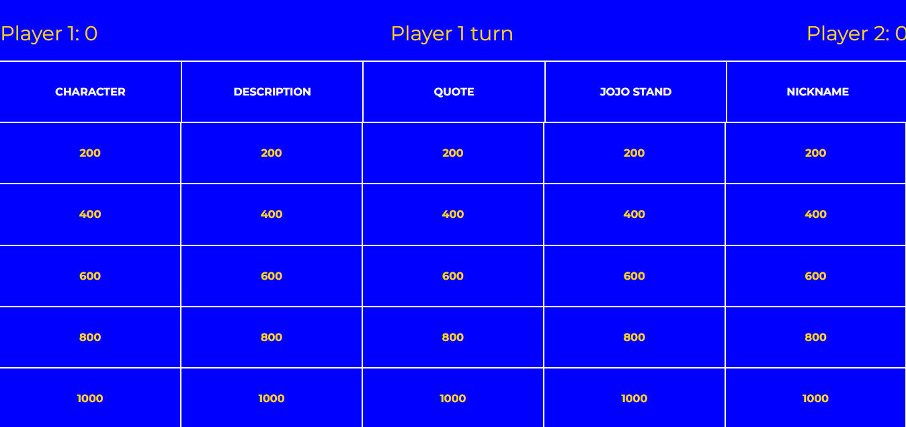
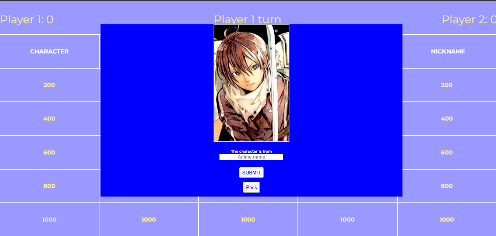
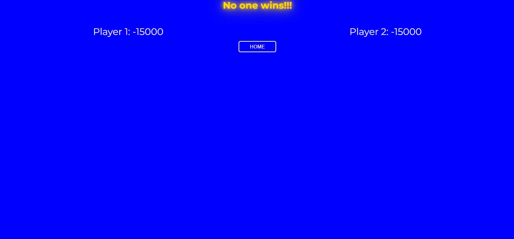
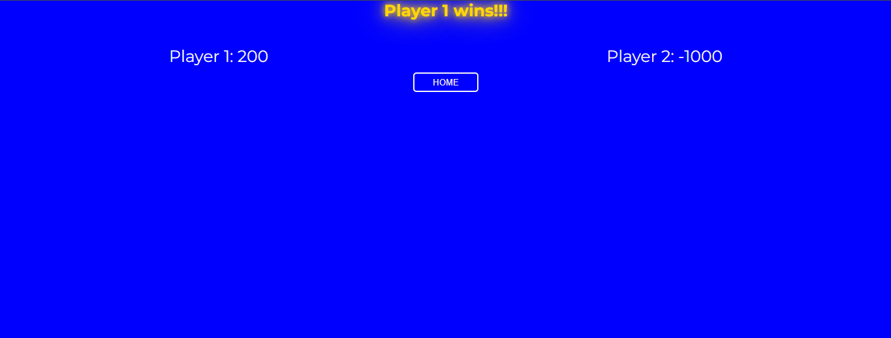
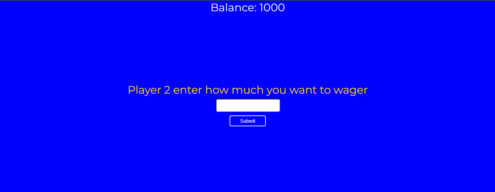
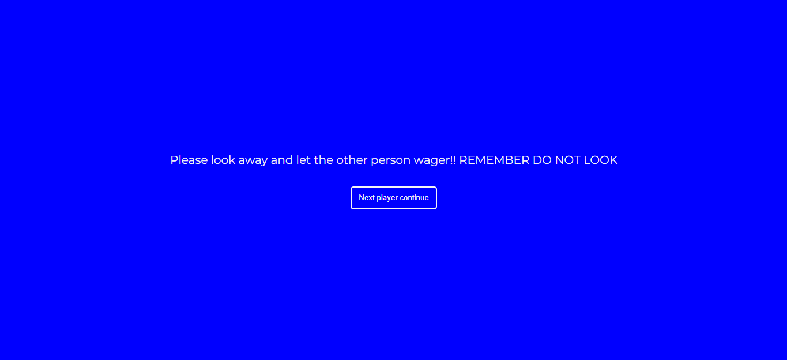
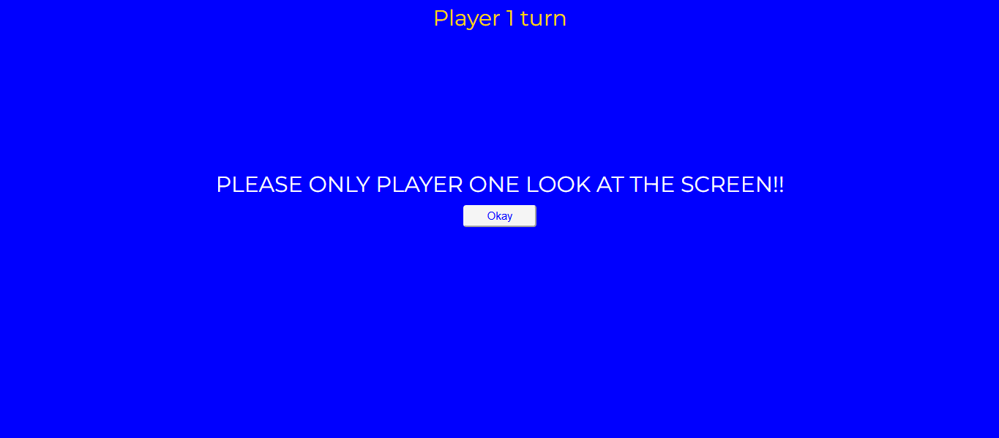
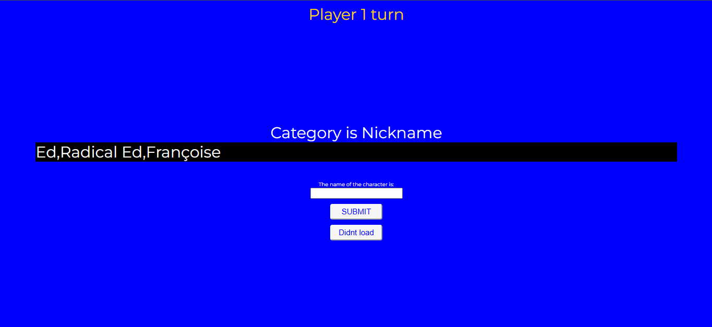
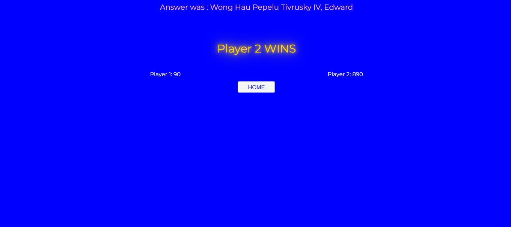

# Jeopardy
A anime based jeopardy game

It's a web based Jeopardy like game where question pops up on the screen whose difficulty is based on the amount of money(?) you pressed on , 2 players play this and the one with the highest amount of money in the end wins the name. This specific game is entirely based on anime related questions.

**IN THE FINAL JEOPARDY, SOMETIMES QUESTION DONT SHOW UP DUE TO API FAULT , PLEASE CLICK DIDNT LOAD IN THAT SITUATION.**

**THERES A RESET BUTTON BELOW THE TABLE IN HOMESCREEN INCASE YOU NEED TO RESET**

Tools used to make this:
>HTML
>CSS
>JS

AI USAGE:
>Helped in finding some api to use (Integrated them to the game myself)
>Used to debug few times (When I was stuck)
>Tidy up the logic one time (Finding the minimum and maximum)

USE CASE:
>Fun game for me to play at school
>That's pretty much it

DIFFICULTY FACED:
>Some apis were really hard to handle at times
>The tiles were inconsistent with their placement, wasted some time almost daily to fix them
>Forgot to add pass button at start , caused a lot of trouble when trying to add it later on

Took the data.json file from https://github.com/ItzSylex/JojoAPI since the api itself doesn't work now

**Gameplay and Screenshots**
>The first screen is this where user 1 selects the tile 

>After clicking on a tile , interface like this pops up

>If the player knows the answer they can input it , or pass

>If player's answer is wrong or chooses to pass, the second player gets to answer it

>Correct answer gives points according to the tile clicked and Incorrect answer deducts it by the same amount

>This goes on until all tiles have been clicked after that it switches to player 2

>Same process repeats until all tiles have been used

>After both player's turn is complete they get redirected to finalscreen.html where if both of their points are above 0, they can wager amount lower or equal to their points. The wagered amount is unknown to the other player. If one player has 0 or -ve points , the other player wins automatically, if both have 0 or -ve no-one wins.

>The no-one wins screen:

>One player wins directly screen:

>Both have +ve value screen:

>After one person wager:

>After second person wagers , they get redirected to finalquestion.html

>After wagering their amount , the players take turn to answer the same question one after the another. If the player gets correct answer, the wager amount gets added to their point and reduced from point if they get incorrect answer. The winner is decided with the points after final jeopardy.

>After clicking continue , they get a random question from a random category , sometimes questions dont load so there's a didnt load button to help with that. click on it until they get a question

>Next player is also greeted with similar page after the first one submits.

>After both submit , the following screen pops up to show who has more points and who won
